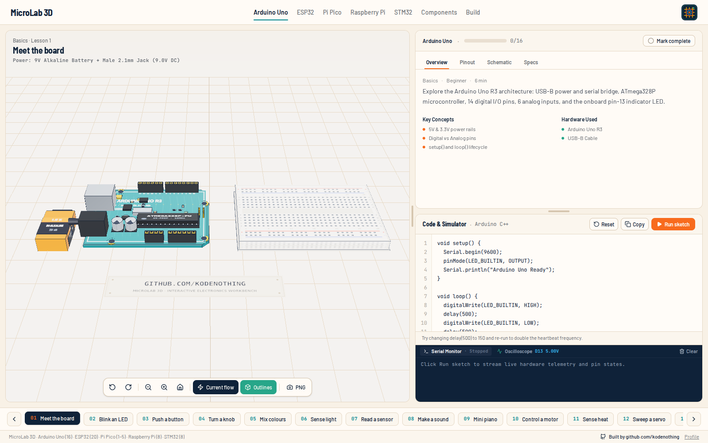
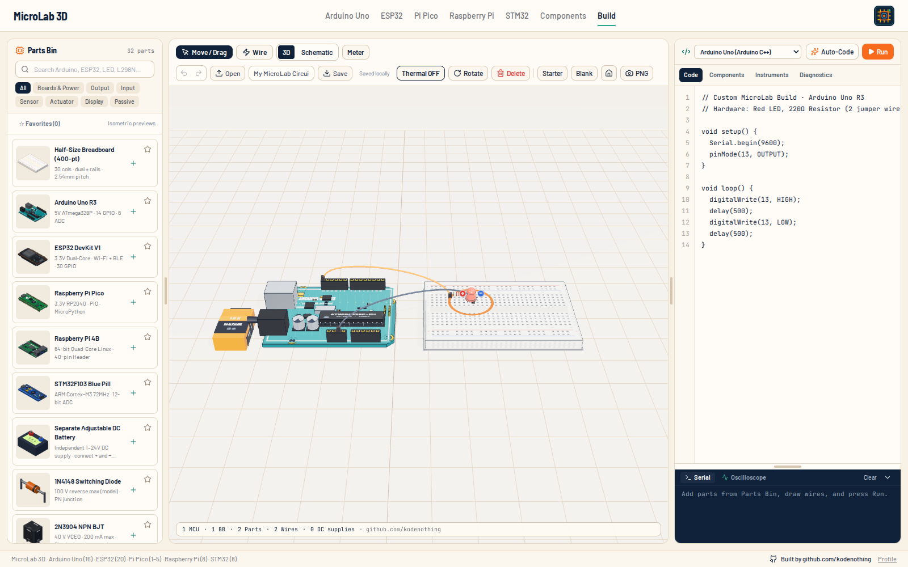
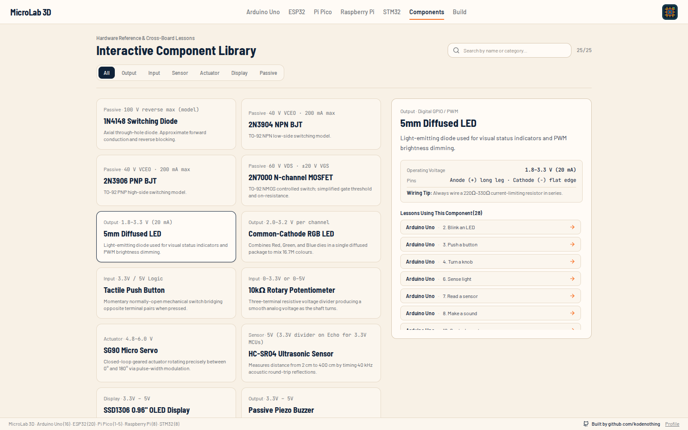

# MicroLab 3D

**Learn electronics. Build circuits. Bring ideas to life.**

MicroLab 3D is an interactive, browser-based electronics learning platform. Explore microcontrollers, connect virtual components, practice programming, and test circuits in a 3D workspace — without needing physical hardware for every experiment.

[**Launch MicroLab 3D →**](https://microlab-3d.vercel.app/)

<!-- showcase-screenshots -->
## Screenshots

Actual screenshots of the hosted MicroLab 3D application.

**Guided lessons**

**3D circuit builder**

**Component explorer**

<!-- /showcase-screenshots -->

## Explore the workbench

| Feature | What you can do |
| --- | --- |
| Guided lessons | Learn through 57 hands-on exercises, from blinking LEDs to sensor and motor projects. |
| 3D circuit builder | Place boards, breadboards, electronic components, and power supplies. Connect pins with virtual jumper wires. |
| Programming workspace | Explore example programs and preview supported firmware behavior. |
| Circuit instruments | Inspect connections, electrical readings, schematics, and signal previews. |
| Thermal and safety feedback | Explore estimated component heating and simulated electrical faults. |
| Project management | Save circuit layouts locally, export projects, and reopen them later. |

## Supported platforms

| Board | Guided lessons |
| --- | ---: |
| Arduino Uno R3 | 16 |
| ESP32 DevKit V1 | 20 |
| Raspberry Pi Pico | 5 |
| Raspberry Pi 4 / 5 | 8 |
| STM32 Blue Pill | 8 |
| **Total** | **57** |

## Start learning

1. Visit [microlab-3d.vercel.app](https://microlab-3d.vercel.app/).
2. Choose a guided lesson or enter **Build** mode.
3. Place and connect your components.
4. Select **Run**, then explore the circuit using the available instruments and diagnostics.

## Who is it for?

MicroLab 3D is designed for students, educators, beginners, and electronics enthusiasts who want a visual, hands-on way to practice embedded systems and circuit design.

## Simulation accuracy

The workbench is intended for education and experimentation. Electrical, thermal, and firmware behavior use models and approximations. It is not a full hardware emulator or a substitute for professional circuit verification. Always consult real component datasheets before building physical circuits.

## Feedback

Have a suggestion, found a bug, or want to request a new component? Share your feedback through [GitHub Issues](https://github.com/kodenothing/microlab-3d/issues).

## About this repository

This is the official public showcase for MicroLab 3D. The application source code is not distributed through this repository.

Created by [kodenothing](https://github.com/kodenothing).

© 2026 MicroLab 3D. All rights reserved. See [Copyright](COPYRIGHT.md).
